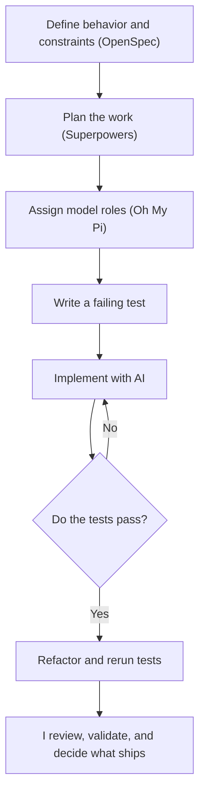
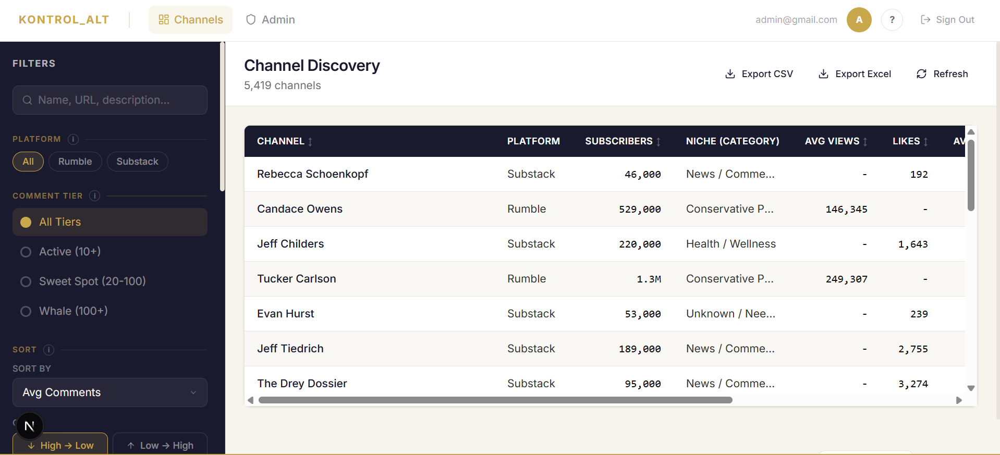
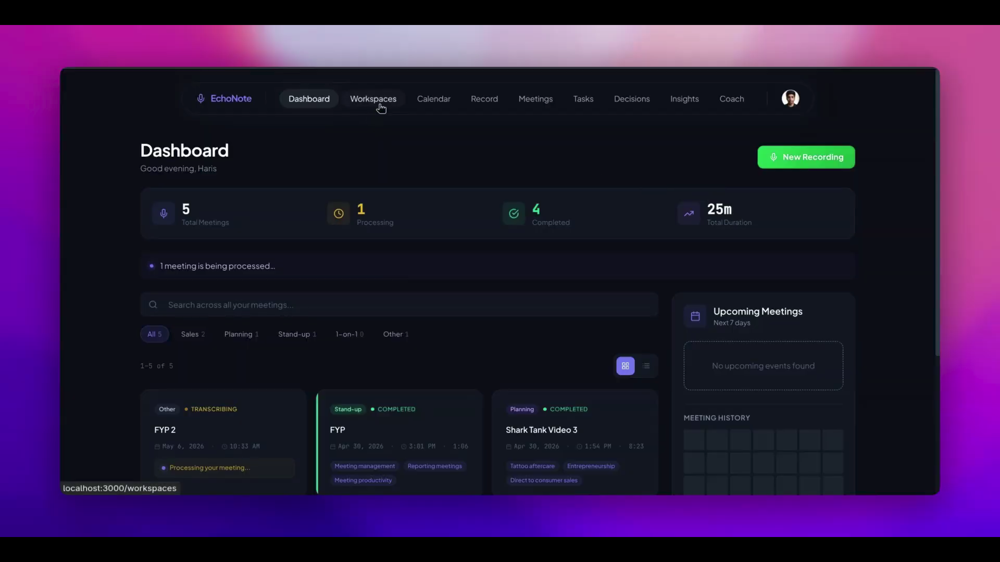
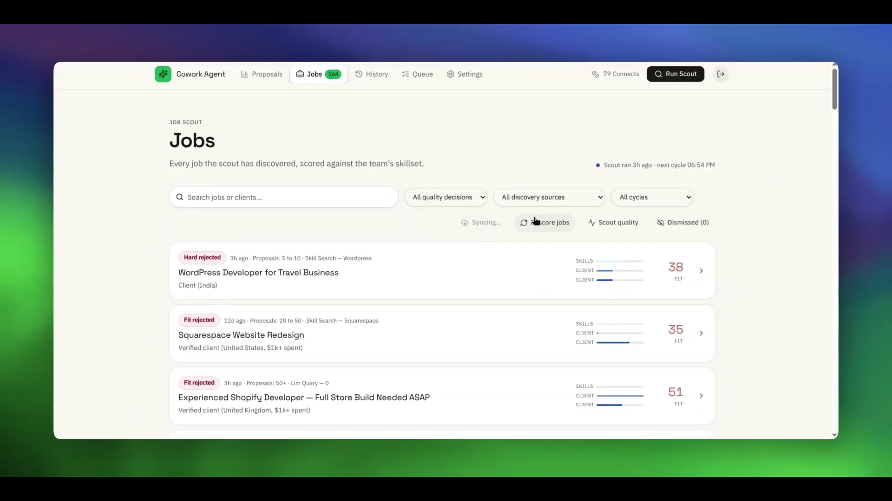
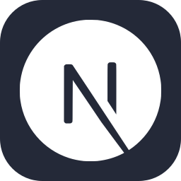
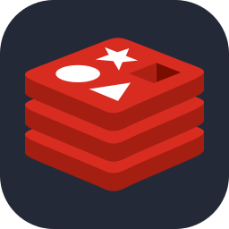
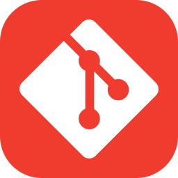

[AI Workflow](#how-i-build-products-with-ai) · [Projects](#projects) · [Tech Stack](#tech-stack) · [Work Experience](#work-experience) · [GitHub Activity](#github-activity)

---

## About Me

I'm Haris Khan, a full-stack software engineer based in Islamabad, Pakistan. I build web apps and SaaS products, business dashboards and internal tools, and bilingual desktop apps. My work includes backend APIs, third-party integrations, workflow automation, and AI features.

I've been freelancing since 2024, shipped 20+ client projects, and earned Top Rated status on Upwork. I'm currently learning Rust. [Current CV](https://drive.google.com/file/d/1vRtTQwTlIfqnCimcGWwiyKspDKYHqf6j/view?usp=drivesdk)

## How I Build Products with AI

I use AI as part of my engineering stack. I set the constraints, validate the work, and make the call on what ships.

> **AI can generate code. Engineering is deciding what should be built, how it should work, whether it is correct, and whether it deserves to reach production.**

### What I own

- Architecture
- Backend & APIs
- Databases
- Frontend & mobile
- Infrastructure
- Security
- Testing & debugging
- Evaluation
- Production delivery

### Where I use AI coding agents

- Planning
- Implementation
- Refactoring
- Debugging
- Testing
- Code review
- Research
- Documentation

I use OpenAI models, Anthropic's Claude, and Google's Gemini through the Oh My Pi agent harness. I assign models different roles based on the quality and turnaround each task needs. [Oh My Pi on GitHub](https://github.com/can1357/oh-my-pi)

I use OpenSpec to define the expected behavior before coding and Superpowers to plan the work and guide test-driven implementation. [OpenSpec](https://github.com/Fission-AI/OpenSpec) · [Superpowers](https://github.com/obra/superpowers)

I turn those requirements into failing tests, use AI to help make them pass, then refactor and rerun the relevant tests.

### Implementation workflow

## Projects

[Portfolio PDF](https://drive.google.com/file/d/1CSYc4F99iLEw5bLF7VELhlRQYB-JRNTg/view?usp=drivesdk) · [Project files](https://drive.google.com/drive/folders/1N4rCOcw_1PpqWHk85L1a3VcIMdd0BI-Z)

### KontrolAlt

Freelance · Deployed

Creator discovery and partnership dashboard for Rumble and Substack with searchable profiles, 30- and 90-day engagement and growth trends, similar-channel matching, AI summaries, shortlist exports, outreach tracking, and worker monitoring. I collected 10,000+ top creator profiles across the two platforms.

**Stack** · Next.js, TypeScript, FastAPI, PostgreSQL, Supabase, Celery, Redis, Docker, Vercel, Render

[Case study](https://drive.google.com/file/d/1khMVZiSxPBLbWKU7Lqyj0i8lUGkeoOqS/view?usp=drivesdk) · [Demo](https://drive.google.com/file/d/1sWmwFjOuH7_EHpwRps4xC7fTDJTkjUP4/view?usp=drivesdk)

### EchoNote

Freelance · Deployed

Turns meeting audio into searchable, speaker-attributed transcripts, structured summaries, decisions, and linked tasks. Background processing reports progress and retries failures. Integrations include Google Calendar and optional Jira and Slack notifications.

**Stack** · React, Node.js, Express, Python, Deepgram, spaCy, Groq, PostgreSQL, Prisma, Liveblocks

[Case study](https://drive.google.com/file/d/1ohmsAlwnRuxgc6mNk_jC5GHNJK2H4YPP/view?usp=drivesdk) · [Demo](https://drive.google.com/file/d/1a1D8_bf3H_SuX5ZXapATKbFmRyBnWaUN/view?usp=drivesdk)

### Upwork Cowork Agent

Freelance · Implemented

Discovers and scores jobs through Upwork MCP and explains each score. Uses portfolio evidence to draft proposals, then runs them through separate writer and critic stages with version history. The workflow ends at draft approval.

**Stack** · React, TypeScript, FastAPI, PostgreSQL, OAuth, Docker

[Case study](https://drive.google.com/file/d/1BA6QwQ_pOkS3DefeJrIKrwaJ67-SqPQ5/view?usp=drivesdk) · [Demo](https://drive.google.com/file/d/19xBuq6qPtoFyMbgGXqHdnCgpX4sE_Dvs/view?usp=drivesdk)

### SAFISH PLUS POS

Freelance · Implemented

English and Urdu point of sale for fish retailers. Supports kilogram checkout, discounts, batch inventory, supplier restocking, FIFO costing, numbered invoices, low-stock alerts, reporting, and CSV and PDF exports. Sales and stock updates are recorded together.

**Stack** · Electron, React, SQLite

[Case study](https://drive.google.com/file/d/15DiZrMSphCgPc3DQ_OGW7BnxOuwAIDf5/view?usp=drivesdk) · [Demo](https://drive.google.com/file/d/1on35a1TigGP_yYciao1v85sKeTBfuRg9/view?usp=drivesdk)

Explore 9 more projects

### SAFISH PLUS Distributor ERP

Freelance · Implemented

English and Urdu fish trading ERP with kilogram and maund conversions, purchasing, owned-stock sales, consignment tracking, commission settlements, vendor advances, customer and vendor ledgers, and 13 reports. Supports Excel and PDF exports.

**Stack** · Electron, React, SQLite

[Case study](https://drive.google.com/file/d/1gVCO-QOQshrbYPkoD8uaPipY_feLZBsB/view?usp=drivesdk) · [Demo](https://drive.google.com/file/d/1mHPgi4KolPc_wnUB-B8gvwEFc7HTCWvy/view?usp=drivesdk)

### 3LT Journal Theme

Freelance · Deployed

Custom responsive theme for an open-access English studies journal. Built the homepage, issue and article pages, archives, search, and author and editorial pages on its existing publishing backend, then deployed the theme to a VPS.

**Stack** · Django, Janeway, CSS, JavaScript

[Case study](https://drive.google.com/file/d/1_8GOLuNPyZmR0q0ZNeVpkXXQBPr3Q-D6/view?usp=drivesdk) · [Demo](https://drive.google.com/file/d/18Yk5wWUmWmobQoN3gtq7Uud4TyXc0EtG/view?usp=drivesdk)

### Pulse Robot

Freelance · Implemented

Responsive Atlas product site with scroll-driven storytelling, animated visuals, and an inquiry interface demonstrated locally.

**Stack** · React, TypeScript, Lottie

[Case study](https://drive.google.com/file/d/12Hxs9goAiMlAEitWhFYy5HKdZx-qye-f/view?usp=drivesdk) · [Demo](https://drive.google.com/file/d/1Uh-rEi7R94Z6c7TADV06LVZ2_gHPdkPf/view?usp=drivesdk)

### Singhar by Sidra

Freelance · Deployed

Headless fashion storefront with editorial content, Shopify catalog and search, product variants, cart and checkout, OAuth for customer accounts, wishlists, and order history.

**Stack** · Shopify Hydrogen, React, TypeScript, GraphQL, Shopify Oxygen, BILDIT CMS, Judge.me

[Case study](https://drive.google.com/file/d/1LvR897xEYpmwsS-B3AlmAGQDePtQ7UM3/view?usp=drivesdk) · [Demo](https://drive.google.com/file/d/1HFu7LmbYLcWPlmonTkQ5PDNtRI6uK6AU/view?usp=drivesdk)

### Goodman Group

Freelance · Implemented

Corporate site with five company profiles, reusable typed content, accessible motion, light and dark themes, and an inquiry form with validation.

**Stack** · Next.js, React, TypeScript, GSAP, Upstash Redis, Resend, Playwright, Axe

[Case study](https://drive.google.com/file/d/1tt5rK1u90q5TBXXlJzbikERdcrcOdqYu/view?usp=drivesdk) · [Demo](https://drive.google.com/file/d/1LjxU8bc6kBdBbdpZa_TU9oKZCMnQJBMm/view?usp=drivesdk)

### Inventory & Finance Management System

Freelance · Implemented

Desktop app for serialized inventory, invoicing, receivables, procurement, vendor payables, partial receipts, payments, reports, and audit history. Transactions keep related accounting and inventory records consistent.

**Stack** · Electron, React, Node.js, Express, Prisma, PostgreSQL

[Case study](https://drive.google.com/file/d/1487AbXoC8qZ05bj7vsTpCv2yajKaZkUY/view?usp=drivesdk) · [Demo](https://drive.google.com/file/d/1SG5_dn1q6Dn4JMUuPBt84dUcvcNSbUdW/view?usp=drivesdk)

### Trulle Portal

Freelance · Deployed

WebGL line-art navigation with interactive peephole previews and transitions to destination pages. Editors configure destinations and media through Elementor controls.

**Stack** · PixiJS, GSAP, React, Zustand, WordPress, Elementor

[Case study](https://drive.google.com/file/d/19ADSFK9Lxadx7BR9W6eZNMNvrFM7gMGS/view?usp=drivesdk) · [Demo](https://drive.google.com/file/d/1PgR4d-74ChpHWgnvOK20gGKkdK9MGLmf/view?usp=drivesdk)

### Trend Finder

Personal · Implemented

Local research workspace that combines Google Trends and Reddit signals to rank product ideas. Supports editable scan inputs, live progress, and saved history.

**Stack** · React, FastAPI, SQLAlchemy, SQLite

[Case study](https://drive.google.com/file/d/1QmEGLuKYTlpN6ipuRsL9D8JyKLOZa7VC/view?usp=drivesdk) · [Demo](https://drive.google.com/file/d/1xrV_BpqrhVKgvzA1_rxwkvsLYE93TfBN/view?usp=drivesdk)

### Software Server Queue Simulation Dashboard

Personal · Implemented

Reproducible queue simulation that compares how traffic, service times, and worker capacity affect response times and SLA breaches.

**Stack** · Streamlit, SimPy, NumPy, pandas, Plotly

[Case study](https://drive.google.com/file/d/1K66zWa_1lB-yyIGN5eAkxEtSU4SCl0SN/view?usp=drivesdk) · [Demo](https://drive.google.com/file/d/1rXXbhGn2CE6LpD6pP9UjTanYOSHVuMqC/view?usp=drivesdk)

[Additional demo · Attire](https://drive.google.com/file/d/1WrpXuhHkTeJDK5f9bgDcR4iS7sAV0lnX/view)

## Tech Stack

| Area | Skills and technologies |
| :--- | :--- |
| Languages |     `SQL`   |
| Frontend |        |
| State and localization |    `right-to-left (RTL) layouts` |
| Backend and APIs |    `REST`   |
| Databases and data access |         |
| Desktop, commerce, and CMS |      |
| AI and integrations | `LLM APIs`    `Groq` |
| Motion and graphics |    |
| Automated testing and accessibility |     `Axe` |
| Data analysis and simulation |   `SimPy`   |
| Authentication |   |
| Version control and cloud deployment |        |

View all 64 skill names

- **Languages** · TypeScript, JavaScript, Python, PHP, SQL, C++, Java
- **Frontend** · React, Next.js, React Router, AngularJS, HTML, CSS, Tailwind CSS
- **State and localization** · Zustand, TanStack Query, i18next, right-to-left (RTL) layouts
- **Backend and APIs** · Node.js, Express, FastAPI, REST, GraphQL, Celery
- **Databases and data access** · PostgreSQL, SQLite, MySQL, MongoDB, Supabase, Prisma, SQLAlchemy, Redis
- **Desktop, commerce, and CMS** · Electron, Shopify Hydrogen, Django templates, WordPress, Elementor
- **AI and integrations** · LLM APIs, MCP, spaCy, Deepgram, Groq
- **Motion and graphics** · GSAP, PixiJS, WebGL
- **Automated testing and accessibility** · Playwright, pytest, Vitest, Testing Library, Axe
- **Data analysis and simulation** · NumPy, pandas, SimPy, Streamlit, Plotly
- **Authentication** · JWT, OAuth
- **Version control and cloud deployment** · Git, GitHub, GitHub Actions, Docker, Vercel, Render, Shopify Oxygen

## Work Experience

| Company | Role | Period | Work |
| :--- | :--- | :--- | :--- |
| Nexus Technologies | Engineer Intern | May–Jul 2025 | Contributed to backend application development. |
| InoTech Solutions | Summer Intern | Apr–Jun 2024 | Developed and maintained user-facing features. |
| Eziline Software House Pvt Ltd | Summer Intern | May–Jul 2023 | Built an iOS and Android chatbot using Chatbase and worked on user-facing features. |
| Samhan Group Of Companies | Summer Intern | Jun–Aug 2022 | Developed a collaboration system for employees and managers to manage projects and performance evaluations. |

## Education

- **BS Software Engineering**, Riphah International University · 2025
- **Intermediate in Computer Science**, I.M.C.B. F-11/3, Islamabad · 2021

## Certificates

30 course and guided-project certificates, including six from Cisco and 24 through Coursera. [Certificates folder](https://drive.google.com/drive/folders/1d5kTJAPAKaeUpnKNAfJTDlUt3NqctyUR)

View all 30 certificates and verification links

| Certificate | Issuer or provider | Awarded | Verification URL |
|---|---|---|---|
| Introduction to Cybersecurity | Cisco | May 30, 2025 | [Credly](https://www.credly.com/badges/4f9ea84b-bc8e-4aeb-ad97-c9c9e2a60aea) |
| JavaScript Essentials 1 | Cisco | Oct 06, 2024 | [Credly](https://www.credly.com/badges/e57a3710-e30a-41fa-a09d-9c00c534356a) |
| JavaScript Essentials 2 | Cisco | Dec 10, 2024 | [Credly](https://www.credly.com/badges/ad6c2dd7-840c-4087-b266-139f3702b018) |
| Networking Basics | Cisco | May 17, 2025 | [Credly](https://www.credly.com/badges/7e5d7cc7-5582-40d2-84ed-2a111572d84b) |
| Python Essentials 1 | Cisco | Nov 17, 2024 | [Credly](https://www.credly.com/badges/acc553be-0e49-4f6d-8ddb-cbcbbd90d60f) |
| Python Essentials 2 | Cisco | Nov 17, 2024 | [Credly](https://www.credly.com/badges/e72958a5-63ab-4ff1-a228-2aa230f41491) |
| Process Map Data using C++ Adjacency List Shortest Path | Coursera Project Network via Coursera | Jan 18, 2023 | [Coursera](https://coursera.org/verify/JENXTJQ9W8SU) |
| Getting Started with Microsoft Word | Coursera Project Network via Coursera | Dec 23, 2021 | [Coursera](https://coursera.org/verify/YC23A7KLLRQC) |
| Introduction to Cloud Computing | IBM via Coursera | Jul 20, 2023 | [Coursera](https://coursera.org/verify/KBVUZ26HWKV7) |
| How Layers Work in Adobe Photoshop | Deprecated Guided Projects via Coursera | Jul 25, 2022 | [Coursera](https://coursera.org/verify/RYVDYP98MK3J) |
| How to create a high-quality flyer in Adobe Photoshop | Coursera Project Network via Coursera | Jul 1, 2022 | [Coursera](https://coursera.org/verify/RGSXRU5XGXCV) |
| Create Animated GIF for Social Media using Adobe Photoshop | Deprecated Guided Projects via Coursera | Jul 2, 2022 | [Coursera](https://coursera.org/verify/V7AU99QHKGQ7) |
| Getting Started with Git and GitHub | IBM via Coursera | Aug 24, 2023 | [Coursera](https://coursera.org/verify/YS7C9Z2EHLZG) |
| Create Your First NoSQL Database with MongoDB and Compass | Deprecated Guided Projects via Coursera | Nov 26, 2023 | [Coursera](https://coursera.org/verify/PVVKYAFAVXA6) |
| Developing Front-End Apps with React | IBM via Coursera | Aug 24, 2023 | [Coursera](https://coursera.org/verify/PVRX55SY76RG) |
| Introduction to Relational Database and SQL | Deprecated Guided Projects via Coursera | Nov 17, 2023 | [Coursera](https://coursera.org/verify/VPX697SKWUKD) |
| Introduction to Web Development with HTML, CSS, JavaScript | IBM via Coursera | Aug 21, 2023 | [Coursera](https://coursera.org/verify/4AA7SB5K7WRN) |
| Introduction to Social Media Marketing | Meta via Coursera | Apr 3, 2024 | [Coursera](https://coursera.org/verify/5YHZKRRGHY3R) |
| Create a Python Application using PyMongo and MongoDB Database | Deprecated Guided Projects via Coursera | Dec 21, 2023 | [Coursera](https://coursera.org/verify/VPJTJ83U63VY) |
| Developing Back-End Apps with Node.js and Express | IBM via Coursera | Aug 25, 2023 | [Coursera](https://coursera.org/verify/QPJPJZL6UUKE) |
| Performing Data Definition and Manipulation in SQL | Coursera Project Network via Coursera | Dec 5, 2023 | [Coursera](https://coursera.org/verify/G5GCNWYP9FCB) |
| CRUD Operations using MongoDB NoSQL | Deprecated Guided Projects via Coursera | Nov 16, 2023 | [Coursera](https://coursera.org/verify/6ZUW5AB9L9RH) |
| Fundamentals of Social Media Advertising | Meta via Coursera | May 16, 2024 | [Coursera](https://coursera.org/verify/EG244U99ZN3G) |
| Social Media Management | Meta via Coursera | Apr 21, 2024 | [Coursera](https://coursera.org/verify/A3PL9BGD6GJM) |
| Command Line Basics in Linux | Deprecated Guided Projects via Coursera | May 21, 2024 | [Coursera](https://coursera.org/verify/9ZYQXK3S68KL) |
| Advertising with Meta | Meta via Coursera | May 30, 2024 | [Coursera](https://coursera.org/verify/CR7W7YL8CENU) |
| Getting Started with Ubuntu Linux | Deprecated Guided Projects via Coursera | May 30, 2024 | [Coursera](https://coursera.org/verify/G2H6DMBMMNJP) |
| Linux: Introduction to Shell Scripting for DevOps | Coursera Project Network via Coursera | May 21, 2024 | [Coursera](https://coursera.org/verify/SSHMHDYEJ4XF) |
| The Bash Shell and Basic Scripting in Linux | Coursera Project Network via Coursera | May 21, 2024 | [Coursera](https://coursera.org/verify/PTRFB9RNS6G8) |
| Game Design and Development 1: 2D Shooter | Michigan State University via Coursera | Sep 16, 2024 | [Coursera](https://coursera.org/verify/EUWJR99A12QP) |

## GitHub Activity

### Contribution Graph

### Contribution Snake

[Contribution snake workflow](.github/workflows/snake.yml)
